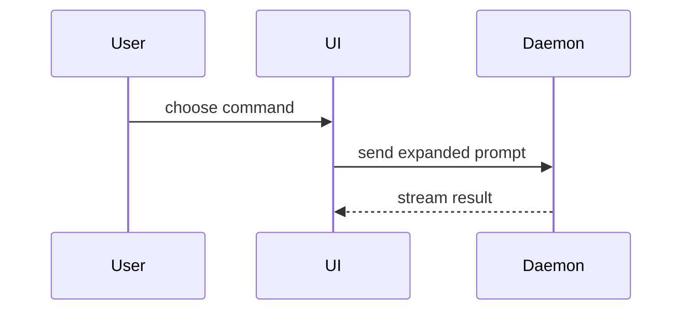

Use this template for writing the PR body:

```markdown
## Summary

<diagram, diff-sketch, or tree>

## Evidence

- **Before:** <screenshot/output/failing test run>
  **After:** <screenshot/output/passing test run>

## Merge Danger

**Door:** <one-way or two-way>

<optional: description>

**Blast Radius:** <one-word description>

<optional: potential ramifications of merge>
```

## Inputs and authority

Ground the draft in the change you were actually asked to describe, not in a recollection of it.

- Where the change is a branch or a range of commits, pin the comparison the body describes: the fixed point and the head, as SHAs, and run the diff on those rather than on a moving name. Name the range in the draft so a reviewer can check it.
- Prefer observed evidence over description: test output you have actually run or been given, the committed spec or ticket the change implements, and recorded Code Review findings. Quote what you have rather than restating it.
- Where a closing report from a build run is in front of you, take the range, the pinned spec, the test commands and their results, and the review findings from that report. It is a source, not a requirement: when the work did not come from one, gather the same things yourself and say which you have.
- Keep observed, claimed, and assumed apart. Output you have is evidence. "The tests pass" with no run beside it is a claim. Something you expect to hold but have not checked is an assumption: label it, and never let it stand as evidence.
- Include every commit that belongs to the described range, including corrections made after a review, and say which part of the range is a correction rather than the implementation.
- Do not invent test results, screenshots, review findings, or rollback guarantees. Where the evidence a section asks for is unavailable, name what is missing and what you looked for, rather than filling the gap with a plausible result.
- Keep the body in the template above and keep it brief. This skill writes the body and nothing else: it pushes no branch, opens or edits no pull request, commits nothing, and changes no issue. Publishing the body is a separate action the human authorizes.

## Sections

Skip all preambles and keep prose brief. Use the user's domain language from `GLOSSARY.md`.

### Summary

Pick the smallest view that makes the key point clear.

- Show logic or an algorithm as pseudocode:

```text
on(save)
  if content is unchanged
    return cached result
  write new content
  return fresh result
```

- Show runtime control flow as a call tree:

```text
submitForm
  createSession
    persistPrompt
    launchAgent
  navigateToSession
```

- Show UI structure as a component tree, including state and module boundaries that matter:

```text
<SessionPage> (apps/example/src/routes/session.tsx)
  useSessionEvents()
  <SessionToolbar>
    <RunSkillButton> (packages/ui)
```

- Show file responsibility or a broad refactor as a shallow file tree:

```text
src/
├── commands/       # parses user actions
├── sessions/       # owns session state
└── transport/      # sends API requests
```

- Show component interaction, control flow, or data flow with Mermaid:



- Use `diff` when the point is what changes and the surrounding shape already exists. Match the diff shape to the topic.

For a component change:

```diff
 <SessionPage>
   useSessionEvents()
   <SessionToolbar>
+    <RunSkillButton />
   <SessionTimeline>
+    <SkillResultCard />
```

For a file-layout change:

```diff
 src/
 ├── commands/
+│   └── show-me.ts       # expands the slash command
 ├── sessions/
-└── transport.ts
+└── transport/
+    ├── client.ts
+    └── stream.ts
```

For a call-tree or call-stack change:

```diff
 submitForm
   createSession
     persistPrompt
+    expandSkillMention
     launchAgent
-  navigateToSession
+  navigateToSession
+    subscribeToEvents
```

For a state or control-flow change:

```diff
 on(save)
-  write content
+  if content is unchanged
+    return cached result
+  write new content
+  invalidate cache
```

- Show the whole block when most of it is new, when omitted context would hide ownership or order, or when the user needs a copyable target shape:

```ts
function expandSkill(command: string): string {
  const skillName = command.slice(1);
  return `use the ${skillName} skill`;
}
```

#### Guidance

Place each visual next to the short text it supports. Keep only the calls, files, props, states, and boundaries needed to answer the user's current question or the options to resolve the current discussion point.

You may use one of these, you may use several, it is unlikely you will use all of them. Use your judgement and don't overwhelm the user.

### Evidence

Concrete evidence that the change works. Show a before and after.

Screenshots are S-tier - when the environment is set up for it and the change is visual.

Execution-based evidence is A-tier. Test results, console output. Show the exact test that now fails and passes, using pseudocode.

Name the command you ran beside the output. Where you have only a passing run and no failing one, say so: a green run on its own is a claim about the change, not a before and after.

### Merge Danger

Describe whether it's a one-way or two-way door. You can walk back through two-way doors, but not one-way doors. A PR that is cheap to roll back is lower risk. Changes that involve destructive actions or hard-to-reverse decisions are one-way doors.

The blast radius is the potential impact or scope of the changes introduced by this PR. Consider all possibilities. Examples are layout shift, breakages for consumers, mobile responsiveness, etc.

The door call and the blast radius are your assessment, not facts the diff proves. Name what you actually checked when you checked it (the rollback path, the callers, the consumers of an interface), and where nothing was checked, say the call is unverified rather than presenting it as settled. A guessed two-way door is the most dangerous line in the body: it invites a reviewer to merge something nobody has walked back.
